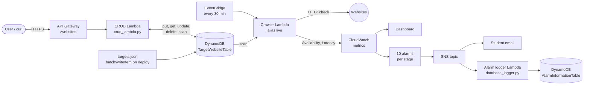

# WebHealth – Website Monitoring Project

## Overview

WebHealth is a serverless application built with **AWS CDK (Python)**. It checks whether websites are working and records their **availability** and **latency** (response time).

The list of websites to monitor (the **target list**) is stored in **Amazon DynamoDB**. Users manage this list through a public **REST API** (Amazon API Gateway) that supports create, read, update and delete (CRUD).

Amazon EventBridge runs the monitoring Lambda every 30 minutes. The Lambda reads the target list from DynamoDB, checks each website and publishes the results to Amazon CloudWatch. When a website is down or slow, a CloudWatch alarm notifies Amazon SNS, which emails the team and triggers a Lambda that saves the alarm in a second DynamoDB table.

The application is deployed by a CI/CD pipeline (AWS CodePipeline) through **Alpha**, **Beta**, **Gamma** and **Prod** stages, with automated tests blocking each stage and a manual approval before production.

## Contents

1. [Architecture](#architecture)
2. [AWS services used](#aws-services-used)
3. [DynamoDB design](#dynamodb-design)
4. [Website management API (CRUD)](#website-management-api-crud)
5. [Website monitoring](#website-monitoring)
6. [CloudWatch metrics, alarms and dashboard](#cloudwatch-metrics-alarms-and-dashboard)
7. [SNS notifications and alarm logging](#sns-notifications-and-alarm-logging)
8. [Operational monitoring and automatic rollback](#operational-monitoring-and-automatic-rollback)
9. [CI/CD pipeline](#cicd-pipeline)
10. [Testing](#testing)
11. [Quality characteristics](#quality-characteristics)
12. [Project structure](#project-structure)
13. [Setup and deployment](#setup-and-deployment)
14. [Troubleshooting](#troubleshooting)
15. [My implementation choices](#my-implementation-choices)
16. [Issues I fixed during deployment](#issues-i-fixed-during-deployment)
17. [Known limitations](#known-limitations)
18. [Removing the deployment](#removing-the-deployment)

## Architecture




How the application works, step by step:

1. The user calls the **API Gateway** endpoint `/websites` to add, view, update or delete websites.
2. API Gateway sends the request to the **CRUD Lambda**, which saves or reads the website in **DynamoDB (TargetWebsiteTable)**.
3. Every 30 minutes, **EventBridge** runs the **WebHealth Lambda** (through its alias `live`).
4. The WebHealth Lambda reads the website list from **DynamoDB** and checks each website.
5. It publishes **Availability** and **Latency** metrics to **CloudWatch**.
6. **CloudWatch alarms** watch these metrics, and the **CloudWatch dashboard** shows them as graphs.
7. When an alarm fires, it sends a message to **SNS**.
8. SNS **emails** the team and triggers the **alarm logger Lambda**, which saves the alarm in **DynamoDB (AlarmInformationTable)**.
9. If the WebHealth Lambda becomes unhealthy after a new deployment, **CodeDeploy** rolls it back to the last working version.
10. Code changes pushed to **GitHub** go through **CodePipeline**: Source, Build (unit and functional tests), UpdatePipeline, Assets, then **Alpha** (smoke tests), **Beta** and **Gamma** (integration tests), a manual approval, and **Prod**.

## AWS services used

| Service | Purpose in this project |

| AWS Lambda | Runs the monitoring, CRUD and alarm-logging code (Python 3.11) |
| Amazon DynamoDB | Stores the target list and the alarm history |
| Amazon API Gateway | Public REST API for CRUD on the target list |
| Amazon EventBridge | Runs the monitoring Lambda every 30 minutes |
| Amazon CloudWatch | Metrics, alarms, dashboard and Lambda Insights (memory) |
| Amazon SNS | Sends alarm notifications by email and to the alarm logger |
| AWS CodeDeploy | Canary deployment and automatic rollback of the monitoring Lambda (switched off on the Free plan) |
| AWS CodePipeline and CodeBuild | Build, test and deploy through Alpha, Beta, Gamma and Prod |
| AWS Secrets Manager | Stores the GitHub token used by the pipeline |
| AWS IAM | Least-privilege permissions for each Lambda |
| AWS CloudFormation and CDK | Infrastructure as code |

## DynamoDB design

The project uses **two DynamoDB tables**, both created in `harisha/harisha_stack.py` with on-demand (`PAY_PER_REQUEST`) billing.

### TargetWebsiteTable – the target list

| Attribute | Type | Description |

| `website_id` | String (**partition key**) | Unique ID of the website |
| `url` | String | Website address to monitor |

- **Seeded on deployment:** the starting target list is kept in `lambda/targets.json`. When the stack is first deployed, an `AwsCustomResource` calls DynamoDB `BatchWriteItem` to place those websites (Western Sydney University, Google, Amazon) in the table, so the table is never empty. To change the starting websites, edit the JSON file only.
- **Written by:** the CRUD Lambda (`put_item`, `update_item`, `delete_item`).
- **Read by:** the CRUD Lambda (`get_item`, `scan`) and the monitoring Lambda (`scan`, with pagination using `LastEvaluatedKey`).

### AlarmInformationTable – the alarm history

| Attribute | Type | Description |

| `alarm_id` | String (**partition key**) | Unique ID (UUID) for each notification |
| `timestamp` | String | Time SNS delivered the alarm |
| `alarm_name` | String | Name of the CloudWatch alarm |
| `state` | String | New alarm state, e.g. `ALARM` or `OK` |
| `reason` | String | Why the alarm changed state |
| `website` | String | Website the alarm is about (if any) |
| `alarm_message` | String | Full original SNS message |

- **Written by:** the alarm logger Lambda (`put_item`).

### Permissions (least privilege)

| Lambda | DynamoDB permission |

| Monitoring Lambda | `grant_read_data` on TargetWebsiteTable |
| CRUD Lambda | `grant_read_write_data` on TargetWebsiteTable |
| Alarm logger Lambda | `grant_write_data` on AlarmInformationTable |

## Website management API (CRUD)

Base URL: the `WebHealthApiUrl` output of the stack. Full details are in [`docs/API.md`](docs/API.md).

| Method | Endpoint | Purpose | Success |

| POST | `/websites` | Add a website (`{"url": "..."}`) | `201 Created` |
| GET | `/websites` | List all websites | `200 OK` |
| GET | `/websites/{website_id}` | Read one website | `200 OK` |
| PUT | `/websites/{website_id}` | Update a website URL | `200 OK` |
| DELETE | `/websites/{website_id}` | Remove a website | `200 OK` |

Errors: `400` for invalid JSON, a missing `url` or a badly formed URL, `404` when the website does not exist, `409` when the URL is already in the list, `405` for an unsupported method.

Example:

```bash
curl -X POST <API_URL>websites -d '{"url": "https://www.python.org/"}'
curl <API_URL>websites
```

### DynamoDB read and write timing

The CRUD Lambda measures each DynamoDB call with `time.perf_counter()` and returns the result in a response header:

- `X-DynamoDB-Write-Time-Ms` – time of the `put_item` call (POST).
- `X-DynamoDB-Read-Time-Ms` – time of the `get_item` call (GET one website).

These times include the AWS SDK and network overhead, not only DynamoDB's internal processing time.

## Website monitoring

The monitoring Lambda (`lambda/lambda_function.py`):

1. Reads every website from **TargetWebsiteTable** (`scan`, following `LastEvaluatedKey` so large lists are fully read).
2. Sends an HTTP request to each URL with a 10-second timeout and measures the response time.
3. Records the website as `UP` (availability `1`) or `DOWN` (availability `0`, status code `0` and the error message).
4. Publishes the availability and latency to CloudWatch **after** the check, so a CloudWatch problem can never make a working website look `DOWN`.

Example result:

```json
{
  "website_id": "1",
  "website": "https://www.westernsydney.edu.au/",
  "status_code": 200,
  "response_time": 0.421,
  "status": "UP"
}
```

## CloudWatch metrics, alarms and dashboard

### Website metrics (namespace `WebHealth`, dimension `Website`)

| Metric | Unit | Meaning |

| `Availability` | Count | `1` when the website responds, `0` when it does not |
| `Latency` | Seconds | Time taken for the website to respond |

### Website alarms

| Alarm | Condition | Action |

| `AvailabilityAlarm0–2` | Availability below `1` in a 30-minute period | SNS |
| `LatencyAlarm0–2` | Latency above `2` seconds in a 30-minute period | SNS |

### Dashboard

The dashboard (one per stage, e.g. `Prod-WebHealthDashboard`) shows:
- website availability and latency graphs, and
- crawler health graphs: invocations and errors, run duration, and memory used.

## SNS notifications and alarm logging

Every alarm publishes to one SNS topic, which has two kinds of subscribers:

1. **Email** – one subscription for each address in `ALERT_EMAILS` (`harisha/harisha_stack.py`). Each recipient must confirm the subscription from the AWS email.
2. **Alarm logger Lambda** (`lambda/database_logger.py`) – reads the alarm details from the SNS message and saves them in **AlarmInformationTable** with a timestamp.

## Operational monitoring and automatic rollback

### Crawler health alarms

| Alarm | Metric | Condition |

| `CrawlerErrorsAlarm` | Lambda `Errors` | 1 or more errors in 5 minutes |
| `CrawlerDurationAlarm` | Lambda `Duration` (time to process a run) | Above 24 seconds (80% of the 30-second timeout) |
| `CrawlerMemoryAlarm` | Lambda Insights `memory_utilization` | Above 80% |
| `CrawlerNotRunningAlarm` | Lambda `Invocations` | Fewer than 1 in an hour |

All four notify SNS.

### Automatic rollback

- EventBridge invokes the Lambda through an alias called **`live`**.
- When new code is deployed, **CodeDeploy** (`LambdaDeploymentGroup`) sends **10% of invocations to the new version for 5 minutes** (canary).
- If the errors, duration or memory alarm fires during that time, CodeDeploy **rolls the alias back to the last working version** automatically.

> **Note:** CodeDeploy is not available on the AWS Free plan, so in this account the deployment group is switched off with `ENABLE_CODEDEPLOY_ROLLBACK = False` in `harisha/harisha_stack.py`. The alias, the alarms and the rollback code are all still in place; setting the switch to `True` on a paid account turns rollback on. A test checks both settings.

## CI/CD pipeline

Defined in `harisha/pipeline_stack.py` using CDK Pipelines. `HarishaStage` creates a fresh `HarishaStack` for each of Alpha, Beta, Gamma and Prod, so test data written in Beta can never reach Prod.

1. **Source** – pulls the code from GitHub (token stored in Secrets Manager as `github-token`).
2. **Build** – installs dependencies, runs all **unit and functional tests** (a failure stops the pipeline), then runs `cdk synth`.
3. **UpdatePipeline** – the pipeline updates itself if its own code changed.
4. **Assets** – uploads the Lambda code.
5. **Alpha** – deploys, then runs the **smoke tests** (`tests/smoke`): the API answers and the target list is in DynamoDB.
6. **Beta** – deploys, then runs the **integration tests** against the real AWS resources.
7. **Gamma** – deploys, then runs the integration tests again.
8. **Prod** – waits for the manual approval **`ReleaseToProduction`**, then deploys and runs the integration tests.

A failed test in any stage stops the next stage from deploying.

## Testing

| Level | File | What it tests | Count |

| Unit | `tests/test_unit.py` | Monitoring Lambda logic: UP/DOWN status, status codes, response time, metrics published (CloudWatch and table mocked) | 12 |
| Unit | `tests/test_crud.py` | CRUD logic: create returns 201 and saves the item, missing or badly formed URL returns 400 without touching DynamoDB, read/write time headers (table mocked) | 6 |
| Functional | `tests/test_crud.py` | Against a DynamoDB table (moto): full CRUD lifecycle with 404 for missing items, and 409 when a POST or PUT would duplicate an existing URL | 3 |
| Functional | `tests/functional/test_dynamodb.py` | Monitoring Lambda reads the target list from DynamoDB; alarm logger saves alarms to DynamoDB (moto) | 2 |
| Functional | `tests/functional/test_stack.py` | The CloudFormation template: 3 Lambdas, 2 tables, seeding, schedule, SNS and emails, 10 alarms, dashboard, API routes, rollback, memory alarm | 15 |
| Integration | `tests/integration/test_crud_integration.py` | Deployed API: CRUD cycle checked **directly in the real DynamoDB table** with read time under 1 s; 400 and 404 errors | 3 |
| Integration | `tests/integration/test_integration.py` | Deployed monitoring Lambda checks all websites; metrics reach CloudWatch | 2 |
| Smoke | `tests/smoke/test_smoke.py` | Alpha stage: the deployed API answers, and every website in `targets.json` is in DynamoDB | 2 |

**Total: 45 tests** (18 unit, 20 functional, 5 integration, 2 smoke).

### Why three levels of DynamoDB testing?

- **Unit tests** use a mock, so they test only the Python logic, for example that a missing URL is rejected before DynamoDB is called.
- **Functional tests** use **moto**, a library that behaves like the real DynamoDB API. They run in the Build stage, **before** anything is deployed, so the real table does not exist yet. They are fast, free and leave no test data behind.
- **Integration tests** run **after** Beta, Gamma and Prod deploy and use the **real** DynamoDB table, proving that API Gateway, Lambda and DynamoDB work together.
- **Smoke tests** run in Alpha as a quick first check that the new stage is alive.

### Running the tests

```bash
# unit + functional (no AWS account needed)
python -m pytest -q tests/test_unit.py tests/test_crud.py tests/functional

# integration (against a deployed stage)
export API_URL=<WebHealthApiUrl>
export WEBHEALTH_FUNCTION_NAME=<WebHealthFunctionName>
export TARGET_TABLE_NAME=<TargetWebsiteTableName>
python -m pytest -q tests/integration
```

## Quality characteristics

### Security
- **Least privilege:** each Lambda gets only the DynamoDB permission it needs (read, read/write or write).
- **Secrets:** the GitHub token is stored in AWS Secrets Manager, never in the code.
- **Input validation:** the API rejects invalid JSON, a missing `url` and URLs that are not `http(s)://` with a real host name (HTTP 400), and refuses duplicate URLs (HTTP 409).
- **Tests never use real credentials:** unit and functional tests use dummy test keys, mocks and moto.

### Performance
- DynamoDB on-demand mode gives single-digit-millisecond reads and writes with no capacity planning.
- Read and write times are measured and returned in response headers, and checked by tests.
- Each website request has a 10-second timeout so one slow site cannot stall the crawler.
- Crawler run duration and memory are monitored with alarms.

### Reliability
- **Automatic rollback** of the monitoring Lambda if errors, duration or memory alarms fire after a deployment (available on a paid account – see the note above).
- **Manual approval** before Prod, so a person checks the release first.
- **Test blockers** in the pipeline: broken code never reaches the next stage.
- An alarm fires if the crawler stops running.
- Metrics are published outside the error handling, so a CloudWatch failure is never misreported as a website outage.
- The target list is seeded on deployment, so monitoring works straight away.

### Usability
- A simple REST API with clear JSON responses and HTTP status codes.
- One dashboard per stage shows website health and crawler health together.
- Alarm emails tell the team immediately, and the alarm history is kept in DynamoDB.

### Scalability
- Lambda, API Gateway and DynamoDB scale automatically with demand.
- The crawler reads the full target list with pagination, so the list can grow beyond one DynamoDB page.

## Project structure

| File or folder | Purpose |

| `app.py` | CDK entry point; creates the pipeline stack |
| `harisha/harisha_stack.py` | All application resources: DynamoDB, Lambdas, API Gateway, CloudWatch, SNS, CodeDeploy |
| `harisha/pipeline_stack.py` | CI/CD pipeline with Alpha, Beta, Gamma and Prod stages |
| `lambda/lambda_function.py` | Monitoring (web crawler) Lambda |
| `lambda/crud_lambda.py` | CRUD API Lambda |
| `lambda/database_logger.py` | Alarm logger Lambda |
| `lambda/targets.json` | Starting target list, seeded into DynamoDB on deploy |
| `tests/` | Unit, functional, integration and smoke tests |
| `docs/API.md` | API documentation |

## Setup and deployment

```bash
source .venv/bin/activate
pip install -r requirements.txt
python -m pytest -q tests/test_unit.py tests/test_crud.py tests/functional
npx cdk synth
```

The pipeline deploys automatically when changes are pushed to the `main` branch:

```bash
git add .
git commit -m "<message>"
git push
```

After the first deployment, each email address in `ALERT_EMAILS` must confirm its SNS subscription.

## Troubleshooting

If a website is reported as `DOWN`:

1. Check the monitoring Lambda logs in CloudWatch Logs for the error message.
2. Check the website's `Availability` and `Latency` metrics on the dashboard.
3. Review the related CloudWatch alarm.
4. Check the alarm email.
5. Check `AlarmInformationTable` for the alarm record and its timestamp.

If a deployment was rolled back: open CodeDeploy, find the stopped deployment, and check which crawler alarm fired.

If a pipeline stage fails: open the failed action in CodePipeline and read the CodeBuild log.

## My implementation choices

- **Seeding with `BatchWriteItem` directly:** the target list is written into DynamoDB by CDK during deployment, instead of calling a Lambda. This needs fewer moving parts and fewer permissions.
- **`website_id` as the partition key:** each website has a stable ID, so its URL can be changed with `PUT` without creating a new item.
- **Rollback on the crawler:** CodeDeploy watches the crawler's errors, run duration and memory, which are the operational metrics the crawler must keep healthy.
- **Duplicate check in code:** the key is `website_id`, not the URL, so DynamoDB cannot reject a repeated address by itself. `website_url_exists` scans the table first and the API returns `409` (on `PUT` it skips the entry's own ID).
- **Routing by HTTP method:** `lambda_handler` reads `httpMethod` and whether `website_id` is in the path, then calls `create_website`, `get_websites`, `get_website`, `update_website` or `delete_website`.
- **Separate test levels:** mocks for logic, moto before deployment, real AWS after deployment, and a quick smoke test in Alpha.

## Issues I fixed during deployment

1. **CodeDeploy blocked on the Free plan.** The first Beta deployment failed with *"needs a subscription for the service (CodeDeploy)"*. I added the `ENABLE_CODEDEPLOY_ROLLBACK` switch so the stack deploys without the deployment group on this account.
2. **Wrong AWS region in tests.** My stacks are in `ap-southeast-2`, but `tests/conftest.py` set `AWS_DEFAULT_REGION` to `us-east-1` for every test, so the real-AWS tests could not find my resources. Using `os.environ.setdefault(...)` keeps the region CodeBuild already provides.

## Known limitations

- The CRUD API is public and has no authentication.
- Alarms and dashboard graphs are created for the websites in `lambda/targets.json`. Websites added later through the API are monitored and get metrics, but do not get their own alarm until they are added to `targets.json` and redeployed.
- `scan` reads the whole table. This is fine for a small target list; a very large list would need a different design.
- Integration tests need a deployed stage and AWS credentials.

## Removing the deployment

Each stage is its own CloudFormation stack, so remove them from last to first, then remove the pipeline:

```bash
for stage in Prod Gamma Beta Alpha; do
  aws cloudformation delete-stack --stack-name $stage-HarishaStack --region ap-southeast-2
done
npx cdk destroy PipelineStack
```